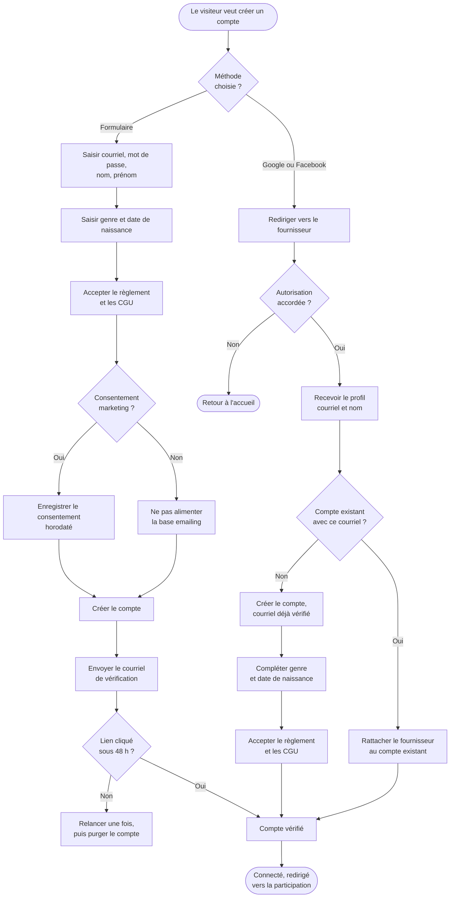
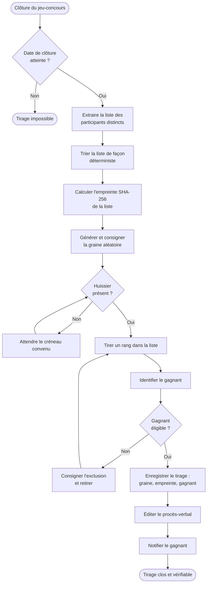
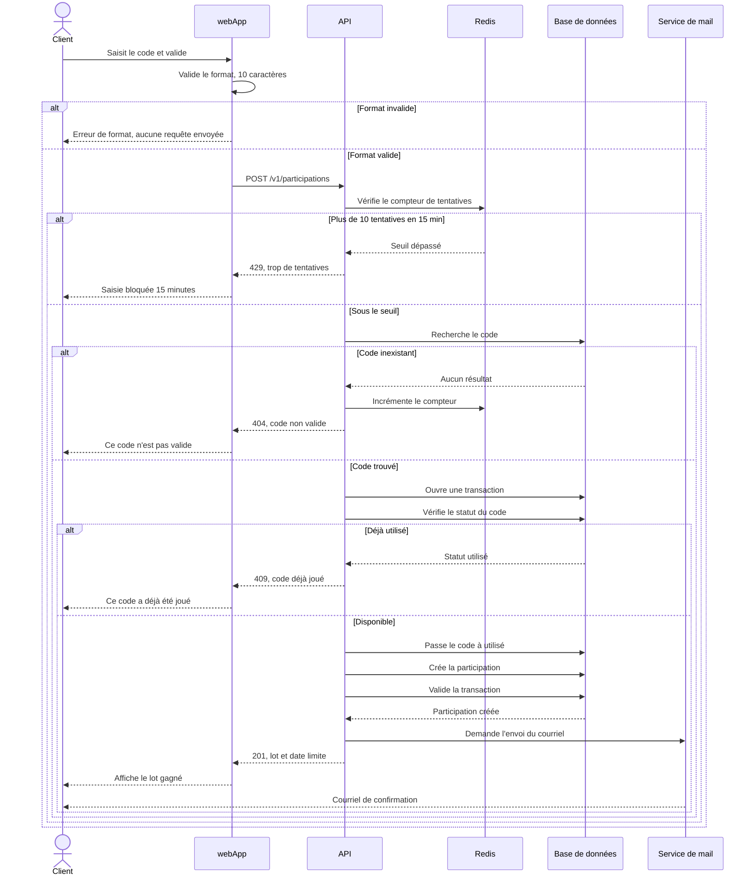
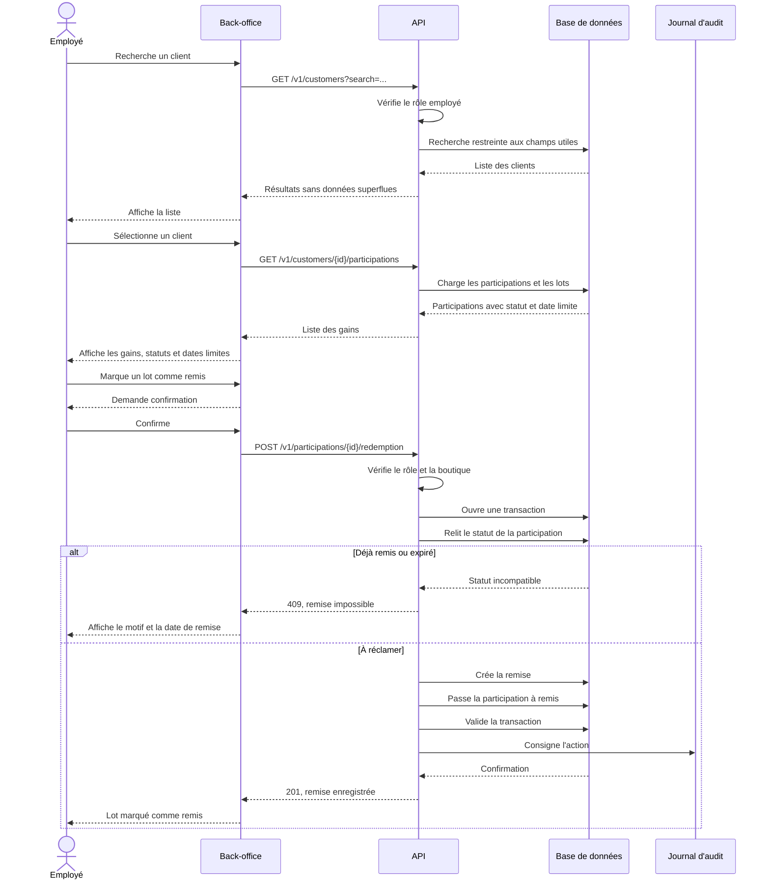

# E. Cahier des charges fonctionnel

> Note de production : les diagrammes sont fournis en notation lisible pour la relecture. Les diagrammes UML doivent être redessinés dans un outil dédié avant l'export, en conservant exactement les mêmes acteurs, cas et messages.

## E.1 Cas d'utilisation

### Choix des cas décrits

Le site comporte huit fonctionnalités demandées par le client. Deux d'entre elles concentrent l'essentiel de la logique métier et des risques, ce sont donc celles que nous détaillons ici.

La participation au jeu, d'abord, parce qu'elle touche au cœur du dispositif : elle vérifie un code parmi 500 000, attribue un gain déjà déterminé, et doit résister aux tentatives de rejeu comme aux erreurs de saisie.

La remise d'un lot en boutique, ensuite, parce qu'elle fait intervenir un troisième acteur, l'employé, et qu'elle engage la responsabilité de Thé Tip Top vis-à-vis du joueur. Une erreur ici se traduit par un lot remis deux fois, ou par un client qui repart les mains vides.

### Diagramme des cas d'utilisation

```
                    SITE DU JEU-CONCOURS THÉ TIP TOP
        ┌──────────────────────────────────────────────────────┐
        │                                                      │
        │      ( Consulter le jeu et les lots )                │
        │                                                      │
 Visiteur ─────( Créer un compte )                             │
        │            △                                         │
        │            │ «extend»                                │
        │      ( S'inscrire via Google ou Facebook )           │
        │                                                      │
        │      ( Se connecter )                                │
        │                                                      │
 Client ───────( Participer avec un code ) ──«include»──▶ ( Vérifier le code )
        │                                                      │
        │      ( Consulter l'historique de ses gains )         │
        │                                                      │
        │      ( Gérer ses données personnelles )              │
        │                                                      │
 Employé ──────( Rechercher un client )                        │
 boutique      ( Consulter les gains d'un client )             │
        │      ( Marquer un lot comme remis )                  │
        │                                                      │
 Admin ────────( Consulter les statistiques )                  │
        │      ( Exporter la base pour l'emailing )            │
        │      ( Paramétrer le jeu-concours )                  │
        │                                                      │
 Système ──────( Générer les 500 000 codes )                   │
        │      ( Effectuer le tirage du gros lot )             │
        │      ( Expirer les gains non réclamés )              │
        │                                                      │
 Caisse ───────( Transmettre un ticket )                       │
 magasin       ( Vérifier un code )                            │
        └──────────────────────────────────────────────────────┘

L'acteur Client hérite de Visiteur. L'acteur Admin hérite d'Employé boutique.
```

### Cas d'utilisation n° 1 : participer au jeu-concours

| Rubrique | Contenu |
|---|---|
| **Identifiant** | UC-01 |
| **Acteur principal** | Client, connecté |
| **Acteurs secondaires** | Aucun |
| **Objectif** | Saisir le code figurant sur un ticket de caisse et découvrir le lot gagné |
| **Déclencheur** | Le client dispose d'un ticket de caisse ou d'une facture de plus de 49 € portant un code à 10 caractères |
| **Préconditions** | Le client possède un compte et il est authentifié. Le jeu-concours est ouvert, la date du jour est comprise entre la date d'ouverture et la date de clôture |
| **Postconditions en cas de succès** | Le code passe au statut « utilisé ». Une participation est créée, rattachée au client, portant le lot et sa date limite de réclamation |
| **Postconditions en cas d'échec** | Aucune donnée modifiée |

**Scénario nominal**

1. Le client accède à la page de participation
2. Le système affiche le formulaire de saisie du code
3. Le client saisit son code à 10 caractères et valide
4. Le système vérifie le format du code
5. Le système vérifie que le code existe en base
6. Le système vérifie que le code n'a pas déjà été utilisé
7. Le système vérifie que le jeu est toujours ouvert
8. Le système marque le code comme utilisé et crée la participation
9. Le système calcule la date limite de réclamation et l'enregistre sur la participation
10. Le système affiche le lot gagné, les modalités de retrait et la date limite
11. Le système envoie un courriel de confirmation au client

**Scénarios alternatifs**

| Réf. | Point de départ | Déroulement |
|---|---|---|
| A1 | Étape 3 | Le client arrive avec un code pré-rempli depuis un lien de courriel. Le système reprend à l'étape 4 |
| A2 | Étape 10 | Le client choisit immédiatement le retrait en ligne. Le système enregistre le canal souhaité et poursuit |

**Scénarios d'exception**

| Réf. | Étape | Condition | Traitement |
|---|---|---|---|
| E1 | 4 | Le code ne fait pas 10 caractères alphanumériques | Message d'erreur précisant le format attendu. Retour à l'étape 3, sans requête en base |
| E2 | 5 | Le code n'existe pas | Message neutre : « ce code n'est pas valide ». Le compteur de tentatives est incrémenté |
| E3 | 6 | Le code a déjà été utilisé | Message indiquant que le code a déjà été joué, avec sa date d'utilisation si c'est par le client lui-même |
| E4 | 7 | Le jeu est clos | Message indiquant la date de clôture. Aucune participation n'est créée |
| E5 | 3 | Plus de 10 tentatives infructueuses en 15 minutes | Blocage temporaire de la saisie pendant 15 minutes |
| E6 | 8 | Deux soumissions simultanées du même code | La contrainte d'unicité en base fait échouer la seconde. Une seule participation existe |

**Règles de gestion**

| Réf. | Règle |
|---|---|
| RG-01 | Un code ne peut être joué qu'une seule fois, quel que soit le compte |
| RG-02 | Le lot est déterminé à la génération du code, jamais au moment de la saisie |
| RG-03 | Le client dispose de 30 jours après la clôture du jeu pour réclamer son lot |
| RG-04 | Tous les codes sont gagnants |

Le message d'erreur E2 est volontairement neutre. Indiquer qu'un code n'existe pas est une information exploitable par quelqu'un qui chercherait à deviner des codes valides. Combiné au blocage E5, cela rend l'énumération inintéressante.

### Cas d'utilisation n° 2 : remettre un lot en boutique

| Rubrique | Contenu |
|---|---|
| **Identifiant** | UC-02 |
| **Acteur principal** | Employé en boutique |
| **Acteurs secondaires** | Client, présent physiquement |
| **Objectif** | Remettre son lot à un client et l'enregistrer comme remis |
| **Déclencheur** | Un client se présente en boutique pour retirer son gain |
| **Préconditions** | L'employé est authentifié et rattaché à une boutique. Le client a une participation au statut « à réclamer » |
| **Postconditions en cas de succès** | La participation passe au statut « remis ». Une remise est enregistrée avec l'employé, la boutique et l'horodatage |
| **Postconditions en cas d'échec** | Aucune donnée modifiée |

**Scénario nominal**

1. L'employé accède à l'interface de remise
2. L'employé recherche le client par son adresse de courriel ou son nom
3. Le système affiche la liste des clients correspondants
4. L'employé sélectionne le bon client
5. Le système affiche ses participations avec le lot, la date de participation, le statut et la date limite
6. L'employé identifie le lot à remettre et demande confirmation d'identité au client
7. L'employé remet physiquement le lot
8. L'employé clique sur « marquer comme remis »
9. Le système demande une confirmation
10. L'employé confirme
11. Le système enregistre la remise avec son identifiant, sa boutique et l'horodatage
12. Le système affiche la confirmation et met à jour le statut

**Scénarios alternatifs**

| Réf. | Point de départ | Déroulement |
|---|---|---|
| A1 | Étape 2 | L'employé recherche directement par le code du ticket que le client présente. Le système va à l'étape 5 |
| A2 | Étape 6 | Le client a plusieurs lots à retirer. L'employé répète les étapes 6 à 11 pour chacun |

**Scénarios d'exception**

| Réf. | Étape | Condition | Traitement |
|---|---|---|---|
| E1 | 3 | Aucun client trouvé | Message invitant à vérifier l'orthographe ou à demander le code du ticket |
| E2 | 5 | Le lot est déjà au statut « remis » | Le système affiche la date, la boutique et l'employé qui l'a remis. Aucune action possible |
| E3 | 5 | La date limite de réclamation est dépassée | Le lot apparaît au statut « expiré » et ne peut plus être remis |
| E4 | 5 | Le lot doit être retiré en ligne | Le système le signale, la remise en boutique reste possible mais doit être confirmée |
| E5 | 11 | Perte de connexion | La remise n'est pas enregistrée. Un message demande de recommencer, aucun enregistrement partiel |

**Règles de gestion**

| Réf. | Règle |
|---|---|
| RG-05 | Un lot ne peut être remis qu'une seule fois |
| RG-06 | Toute remise est tracée avec l'employé, la boutique et l'horodatage |
| RG-07 | Un lot dont la date limite est dépassée ne peut plus être remis |
| RG-08 | Un employé ne voit que les informations nécessaires à la remise, pas l'ensemble du profil client |

La règle RG-08 mérite un mot. L'employé doit pouvoir identifier un client et voir ses lots, rien de plus. Lui donner accès à la date de naissance ou à l'historique complet dépasserait la finalité du traitement, ce que le RGPD n'autorise pas.

## E.2 Arborescence

### Méthode

L'arborescence résulte d'un tri de cartes ouvert mené auprès de 12 participants correspondant aux cibles définies en partie C. Chaque participant a regroupé librement 24 cartes représentant les contenus et fonctions du site, puis nommé ses groupes.

Trois enseignements en sont ressortis.

Les participants ont spontanément séparé « comprendre le jeu » de « jouer ». Personne n'a mélangé les deux, ce qui a conduit à distinguer clairement la page de présentation de la page de participation, plutôt que de tout regrouper sur une page d'accueil unique.

Le règlement a été rattaché tantôt aux informations légales, tantôt à la présentation du jeu. Il apparaît donc aux deux endroits, avec un lien depuis la présentation vers la page dédiée.

L'historique des gains a systématiquement été placé dans l'espace personnel, jamais dans la navigation principale. Il n'apparaît donc qu'une fois le client connecté.

### Arborescence retenue

```
Accueil
│
├── Le jeu-concours
│   ├── Comment participer
│   ├── Les lots à gagner
│   └── Règlement du jeu
│
├── Participer                          [connexion requise]
│   └── Résultat de la participation
│
├── Mon compte                          [connexion requise]
│   ├── Mes gains
│   │   └── Détail d'un gain
│   ├── Mes informations
│   └── Mes données et confidentialité  [RGPD]
│
├── Connexion / Inscription
│   ├── Connexion
│   ├── Inscription par formulaire
│   ├── Inscription via Google ou Facebook
│   └── Mot de passe oublié
│
├── Nos boutiques
│
├── Contact
│
└── Pages légales
    ├── Mentions légales
    ├── Conditions générales d'utilisation
    ├── Politique de confidentialité
    └── Gestion des cookies

ESPACE EMPLOYÉ                          [rôle employé]
├── Rechercher un client
└── Gains d'un client
    └── Confirmation de remise

BACK-OFFICE                             [rôle administrateur]
├── Tableau de bord
├── Statistiques
│   ├── Tickets distribués et utilisés
│   ├── Lots gagnés et remis
│   └── Profils des gagnants
├── Participants
├── Export pour l'emailing
├── Paramétrage du jeu
└── Tirage au sort
```

La navigation principale ne comporte que cinq entrées, ce qui reste dans les limites de ce qu'un visiteur mémorise. L'espace employé et le back-office sont physiquement séparés du site public, comme prévu dans l'architecture technique.

## E.3 Diagrammes d'activité

Ces deux diagrammes portent sur des fonctionnalités différentes de celles décrites en E.1.

### Activité 1 : création de compte et connexion



Le point sensible se situe à la passerelle R. Sans ce contrôle, un client inscrit par formulaire qui reviendrait via Google se retrouverait avec deux comptes, donc un historique de gains coupé en deux. Le rattachement au compte existant évite ce doublon.

L'étape U existe parce que ni Google ni Facebook ne fournissent le genre et la date de naissance. Or ces données sont nécessaires aux statistiques demandées par le client. Elles sont donc collectées après coup, avec la même finalité affichée.

### Activité 2 : tirage au sort du gros lot



Trois éléments rendent ce tirage contestable ou incontestable, selon qu'on les met en place ou non.

L'extraction porte sur les participants distincts, pas sur les participations. C'est la traduction directe de la règle du sujet selon laquelle le nombre de participations n'augmente pas les chances de gagner.

Le tri déterministe et l'empreinte de la liste permettent de prouver a posteriori que l'univers du tirage n'a pas été modifié. Sans cette empreinte, rien n'empêcherait de contester la composition de la liste.

La graine conservée permet de rejouer le tirage à l'identique devant l'huissier. Un tirage non reproductible ne se vérifie pas.

## E.4 Diagrammes de séquence

Ces deux diagrammes détaillent les échanges techniques des deux cas d'utilisation décrits en E.1.

### Séquence 1 : participation avec un code



La transaction ouverte avant la vérification du statut n'est pas un détail. Elle garantit que deux requêtes concurrentes sur le même code ne peuvent pas créer deux participations, puisque la seconde échouera sur la contrainte d'unicité au moment de valider.

Le courriel est demandé après la validation de la transaction. Envoyer avant reviendrait à confirmer un gain qui pourrait ne jamais être enregistré.

### Séquence 2 : remise d'un lot en boutique



La relecture du statut à l'intérieur de la transaction est ce qui empêche deux employés de remettre le même lot depuis deux postes différents. Vérifier le statut à l'affichage ne suffirait pas, puisque plusieurs minutes peuvent s'écouler entre l'affichage et la confirmation.
