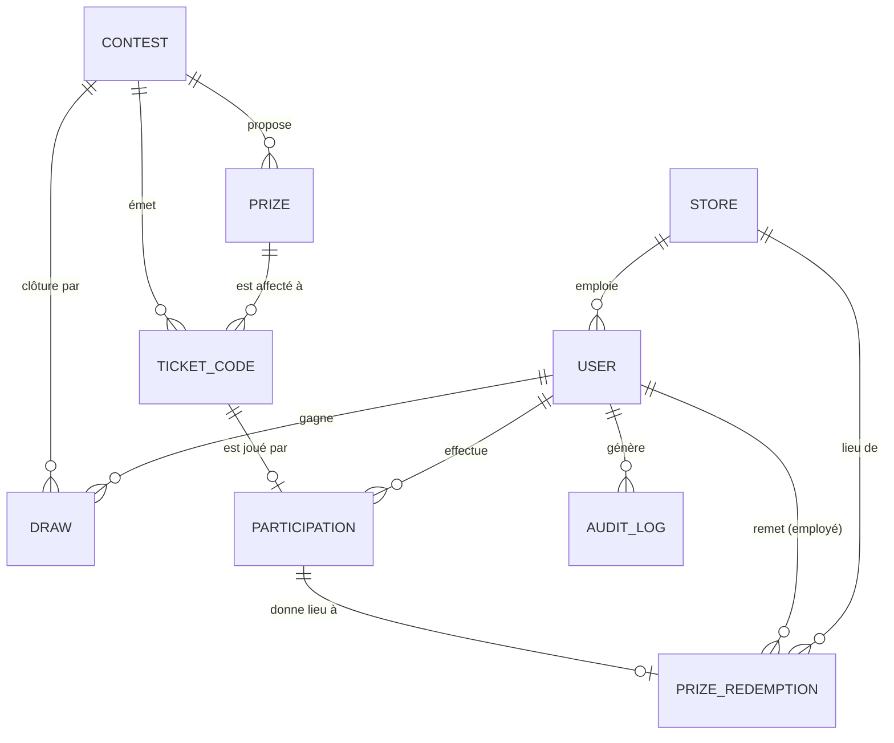

# E.5 MCD et MLD

> Section du cahier des charges. Le modèle physique de référence est le schéma Prisma
> versionné dans `06-app/db/schema/` (validé : `prisma validate` ✅).
> **Convention : le code est intégralement en anglais**, le dossier reste en français.
> Le tableau de correspondance ci-dessous fait le pont pour le jury.

## Correspondance dossier (FR) ↔ implémentation (EN)

| Entité du MCD | Modèle Prisma | Table |
|---|---|---|
| Utilisateur | `User` | `User` |
| Boutique | `Store` | `Store` |
| Jeu-concours | `Contest` | `Contest` |
| Lot | `Prize` | `Prize` |
| Code de ticket | `TicketCode` | `TicketCode` |
| Participation | `Participation` | `Participation` |
| Remise de lot | `PrizeRedemption` | `PrizeRedemption` |
| Tirage au sort | `Draw` | `Draw` |
| Journal d'audit | `AuditLog` | `AuditLog` |
| Session / Compte OAuth | `Session` / `Account` | Better Auth |

---

## 1. Modèle conceptuel de données (MCD)

### Diagramme entité-association



### Cardinalités et règles de gestion associées

| Association | Cardinalités | Règle de gestion (justification) |
|---|---|---|
| Jeu-concours **émet** Code | 1,N ↔ 1,1 | Les **500 000 codes** sont émis dès l'ouverture du jeu |
| Lot **est affecté à** Code | 1,N ↔ 1,1 | ⚠️ Le lot est figé **à la génération**, jamais tiré à la saisie, c'est ce qui garantit la répartition 60/20/10/6/4 % |
| Code **est joué par** Participation | 0,1 ↔ 1,1 | Un code n'est jouable **qu'une seule fois** (contrainte d'unicité en base) |
| Utilisateur **effectue** Participation | 0,N ↔ 1,1 | Un client peut jouer autant de codes qu'il possède de tickets |
| Participation **donne lieu à** Remise | 0,1 ↔ 1,1 | Un lot ne peut être remis qu'une fois, ce qui interdit le double retrait |
| Utilisateur (employé) **remet** | 0,N ↔ 1,1 | Traçabilité : on sait toujours **qui** a remis le lot |
| Boutique **lieu de** Remise | 0,N ↔ 0,1 | Optionnel : le sujet autorise la réclamation **en magasin ou en ligne** |
| Jeu-concours **clôture par** Tirage | 1,N ↔ 1,1 | Le tirage du gros lot a lieu à l'issue du jeu, sous contrôle d'huissier |
| Utilisateur **gagne** Tirage | 0,N ↔ 0,1 | Le gagnant du gros lot est un participant tiré au sort côté serveur |

---

## 2. Modèle logique de données (MLD)

*(clé primaire soulignée, `#` = clé étrangère, `U` = contrainte d'unicité)*

```
USER (id, email U, emailVerified, lastName, firstName, phone, role,
      gender, birthDate, postalCode,
      termsAcceptedAt, contestRulesAcceptedAt, marketingConsent, marketingConsentAt,
      anonymizedAt, #storeId, createdAt, updatedAt, deletedAt)

STORE (id, name, address, postalCode, city, phone, active, openedAt,
       createdAt, updatedAt)

CONTEST (id, name, slug U, startsAt, endsAt, claimDeadline,
         minimumPurchaseCents, plannedCodeCount, codeLength,
         bailiffName, rulesUrl, rulesFiledAt, createdAt, updatedAt)

PRIZE (id, label, description, type, valueCents, targetPercentage,
       targetQuantity, rank, #contestId, createdAt, updatedAt)
       U(contestId, label)

TICKET_CODE (id, code U CHAR(10), #prizeId, #contestId, status, usedAt, createdAt)

PARTICIPATION (id, #userId, #ticketCodeId U, prizeStatus, claimDeadline,
               ipHash, createdAt)

PRIZE_REDEMPTION (id, #participationId U, #issuedById, #storeId,
                  channel, note, issuedAt)

DRAW (id, #contestId, executedAt, participantCount, seed,
      participantsFingerprint, #winnerId, bailiffName, affidavitUrl)

AUDIT_LOG (id, #userId, action, entity, entityId, metadata, ip, createdAt)
```

### Choix de modélisation à défendre en soutenance

| Choix | Justification |
|---|---|
| **Le lot est porté par le code, pas par la participation** | Exigence explicite du sujet : les 500 000 codes existent en base **avec leur gain déjà associé**. Tirer le lot à la saisie rendrait les pourcentages non garantis. |
| `code` en **`CHAR(10)` + index unique** | Longueur fixe connue (10 caractères), index plus compact sur 500 000 lignes. L'unicité est portée par la **base** : c'est le seul garde-fou opposable si le générateur collisionne. |
| `ticketCodeId` **unique** sur `PARTICIPATION` | Empêche le rejeu d'un code par deux comptes ou par double soumission concurrente, sans verrou applicatif. |
| `participationId` **unique** sur `PRIZE_REDEMPTION` | Un lot ne peut être remis qu'une seule fois, ce qui protège du double retrait en boutique. |
| `claimDeadline` **dupliquée** sur la participation | La date opposable au joueur est celle en vigueur le jour où il a joué, même si le paramétrage du jeu change ensuite. Dénormalisation assumée. |
| Montants en **centimes** (`Int`) | Aucun arrondi flottant possible sur les statistiques et les valeurs de lots. |
| `birthDate` plutôt qu'un âge | Minimisation RGPD et donnée non périssable ; l'âge est calculé au moment de la statistique. |
| `ipHash` (SHA-256 + sel) | Anti-fraude sans stocker de donnée personnelle en clair. |
| `anonymizedAt` plutôt qu'une suppression | Le droit à l'effacement doit coexister avec l'obligation de conserver des participations auditables par l'huissier : on anonymise, on ne détruit pas. |
| `seed` + `participantsFingerprint` sur `DRAW` | Rend le tirage **rejouable et vérifiable** devant l'huissier : preuve que l'univers du tirage n'a pas été modifié après coup. |
| Table `AUDIT_LOG` | Traçabilité RGPD des actions sensibles (remise de lot, export de données, tirage). |

---

## 3. Volumétrie et indexation

| Table | Volume estimé | Justification |
|---|---|---|
| `TICKET_CODE` | **500 000** | Imposé par le sujet |
| `PARTICIPATION` | ≤ 500 000 | Au plus un code joué = une participation |
| `USER` | 50 000 à 150 000 | Hypothèse : 10 à 30 % des tickets convertis en compte |
| `PRIZE_REDEMPTION` | ≤ nb de participations | Tous les lots ne seront pas réclamés |
| `PRIZE` | 6 | 5 lots de ticket + 1 gros lot |
| `STORE` | 10 | Les 10 boutiques, dont Nice |

**Requête la plus sollicitée** : vérification d'un code saisi par un joueur.
`SELECT ... FROM TicketCode WHERE code = ?` → index unique, coût logarithmique constant quel que soit le volume.

**Index déclarés** (règle `deal-israel` : *aucune requête sans index*) :

| Table | Index | Requête servie |
|---|---|---|
| `TicketCode` | `code` (unique) | Saisie d'un code par le joueur |
| `TicketCode` | `status` | Stat admin « nombre de tickets utilisés » |
| `TicketCode` | `prizeId, status` | Stat admin « nombre de lots déjà gagnés » |
| `TicketCode` | `usedAt` | Courbe de participation dans le temps |
| `Participation` | `userId, createdAt` | « Historique de mes gains », trié |
| `Participation` | `prizeStatus` | Lots restant à remettre |
| `Participation` | `claimDeadline` | Job d'expiration automatique à J+30 |
| `User` | `gender, birthDate` | Statistiques des gagnants par sexe et âge |
| `User` | `marketingConsent` | Export de la base emailing |
| `PrizeRedemption` | `storeId, issuedAt` | Activité par boutique |

---

## 4. Traçabilité avec les exigences du sujet

| Exigence | Où elle est traitée dans le modèle |
|---|---|
| 500 000 codes pré-générés avec gain associé | `TicketCode.prizeId` non nul dès l'insertion |
| Répartition 60/20/10/6/4 % garantie | `Prize.targetPercentage` + `Prize.targetQuantity` (valeurs de contrôle du test automatisé) |
| Inscription Google/Facebook + formulaire | `Account.providerId` (Better Auth) |
| Participation via numéro de ticket | `Participation` ← `TicketCode` |
| Historique des gains du client | `Participation.userId` + `prizeStatus` |
| Statistiques admin (tickets, lots, sexe, âge) | `TicketCode.status`, `Prize`, `User.gender`, `User.birthDate` |
| Données exploitées pour l'emailing | `User.marketingConsent` + `marketingConsentAt` |
| Employé boutique : voir et marquer « remis » | `PrizeRedemption` + `User.storeId` |
| Tirage au sort côté serveur, sans avantage au volume | `Draw` sur participants distincts + `seed` + `participantsFingerprint` |
| RGPD | Consentements horodatés, `anonymizedAt`, `ipHash`, `AuditLog` |
| Fenêtre de réclamation 30 j + 30 j | `Contest.endsAt` / `Contest.claimDeadline` / `Participation.claimDeadline` |
| Seuil de 49 € | `Contest.minimumPurchaseCents = 4900` |
