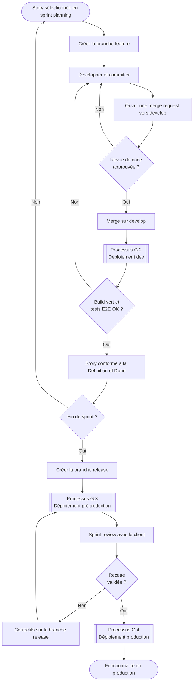
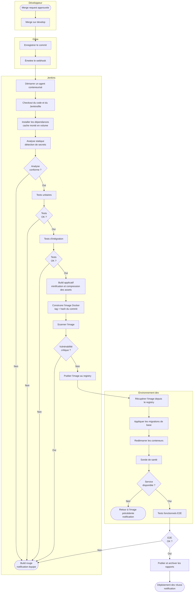
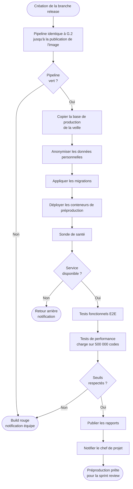
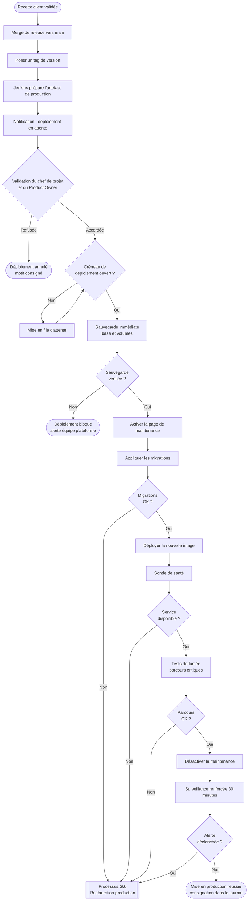
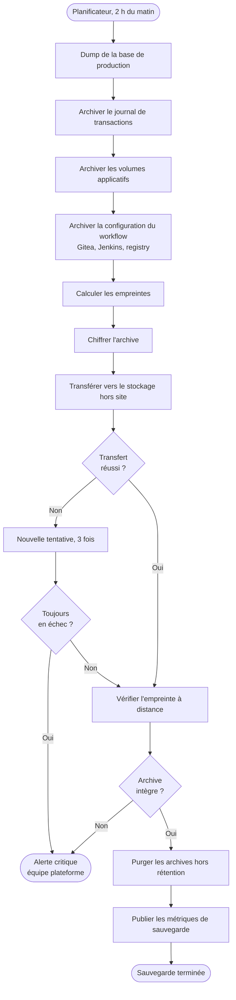
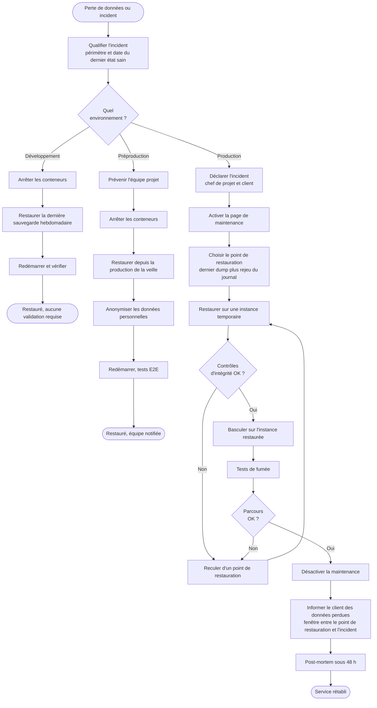

# G. Procédures

Cette partie décrit les processus que le workflow automatise, sous forme de diagrammes BPMN, puis les modes opératoires destinés aux utilisateurs.

> Note de production : les diagrammes ci-dessous sont fournis en notation lisible pour la relecture. Ils doivent être redessinés dans un éditeur BPMN avant l'export du dossier, en conservant exactement les mêmes couloirs, tâches et passerelles. Le sujet demande des diagrammes BPMN, la forme compte donc autant que le contenu.

## G.0 Conventions de lecture

| Élément BPMN | Usage dans nos diagrammes |
|---|---|
| Pool | Un acteur ou un système : développeur, Gitea, Jenkins, environnement cible |
| Couloir | Une sous-responsabilité à l'intérieur d'un acteur |
| Événement de début | Ce qui déclenche le processus, en fin ou en clair sur le schéma |
| Tâche | Une action. Les tâches automatiques sont marquées d'un engrenage, les tâches humaines d'un personnage |
| Passerelle exclusive | Un choix, une seule branche est empruntée |
| Événement de fin d'erreur | Le processus s'arrête sur un échec, avec notification |

Trois acteurs reviennent dans tous les processus. Le développeur, qui déclenche par un `git push`. Jenkins, qui exécute. L'équipe plateforme, qui n'intervient qu'en cas d'échec ou de décision.

## G.1 Diagramme d'activité : cycle de vie d'une fonctionnalité

Ce premier diagramme donne la vue d'ensemble, du besoin exprimé jusqu'à la mise en production. Les processus suivants en détaillent les trois phases de déploiement.

Le point important se situe à la passerelle H. Tant que le build n'est pas vert, la story n'est pas terminée, même si le code est écrit. C'est ce qui rend la Definition of Done vérifiable au lieu de déclarative, comme annoncé en B.2.

## G.2 Processus de déploiement en développement

Entièrement automatique, déclenché par une fusion sur `develop`.

Deux choses méritent d'être signalées. Le tag de l'image reprend le hash du commit, ce qui permet de savoir à tout instant quelle version exacte tourne sur quel environnement. Et le retour à l'image précédente en cas d'échec de la sonde de santé est automatique, sans intervention humaine.

## G.3 Processus de déploiement en préproduction

Automatique lui aussi, déclenché par la création ou la mise à jour d'une branche `release/*`. Il se distingue du précédent sur trois points : le jeu de données, les tests de performance et la notification au client.

L'anonymisation à l'étape E n'est pas une précaution de confort. La préproduction est accessible au client et sert aux démonstrations, elle ne doit donc jamais contenir les données réelles des participants au jeu-concours. C'est une obligation RGPD, pas un choix technique.

Les tests de performance ne tournent qu'ici, et pas en développement, parce qu'ils demandent une base complète et plusieurs minutes d'exécution. Les lancer à chaque commit ralentirait le retour aux développeurs sans rien apporter.

## G.4 Processus de déploiement en production

C'est le seul processus qui comporte une décision humaine, pour les raisons expliquées en D.1.

Quatre garde-fous encadrent ce processus. La sauvegarde préalable est vérifiée avant toute modification, et son échec bloque le déploiement. Les migrations sont jouées avant le basculement de l'image, ce qui permet de détecter un problème de schéma avant que le trafic n'arrive. Les tests de fumée couvrent les parcours critiques, dont la saisie d'un code de jeu. Et la surveillance renforcée pendant trente minutes attrape les régressions qui ne se voient qu'en charge réelle.

Le créneau de déploiement mérite une explication pour le client. Pendant les soixante jours du jeu-concours, aucune mise en production n'est possible entre 9 h et 21 h, ce sont les heures d'affluence en boutique. Un correctif urgent reste évidemment possible, par la procédure de hotfix.

## G.5 Procédure de sauvegarde de la production

Automatique et planifiée, sans intervention humaine en fonctionnement normal.

En complément, le journal de transactions de la base de production est archivé toutes les quinze minutes. C'est ce qui permet de tenir le RPO de quinze minutes annoncé en D.3, là où le dump quotidien seul limiterait la perte maximale à vingt-quatre heures.

Un test de restauration complet est exécuté le premier lundi de chaque mois sur l'environnement de préproduction. Il est chronométré, et son résultat consigné. Une sauvegarde qui n'a jamais été restaurée reste une hypothèse.

## G.6 Procédures de restauration

Le sujet demande explicitement une procédure de restauration pour les trois environnements. Elles partagent le même début, puis divergent selon les enjeux.

Trois différences structurent ces trois variantes.

En développement, on écrase sans précaution. Les données sont des jeux de test, la perte est sans conséquence, et la rapidité prime.

En préproduction, la restauration se fait depuis la production, ce qui impose de repasser par l'anonymisation. Sauter cette étape reviendrait à exposer des données réelles sur un environnement accessible au client.

En production, la restauration passe par une instance temporaire avant tout basculement. Restaurer directement sur l'instance en place ferait perdre la possibilité de revenir en arrière si l'archive s'avérait corrompue. L'étape F11 est également obligatoire : le client doit savoir précisément quelles données ont été perdues, en particulier si des participations au jeu-concours sont concernées, puisque cela engage sa responsabilité vis-à-vis des joueurs et de l'huissier.

## G.7 Modes opératoires pour les utilisateurs

Les diagrammes décrivent les processus. Ces fiches décrivent les gestes, pour les personnes qui les exécutent.

### Fiche 1 : livrer une fonctionnalité, pour les développeurs

1. Créer la branche depuis `develop` : `git checkout -b feature/nom-de-la-fonctionnalite`
2. Committer en suivant la convention de nommage des messages
3. Pousser la branche, puis ouvrir une merge request vers `develop` dans Gitea
4. Attendre le build. Le résultat s'affiche directement sur la merge request
5. Si le build est rouge, ouvrir le rapport depuis le lien de la notification, corriger, repousser
6. Demander une revue à un membre de l'équipe. La fusion est impossible sans approbation
7. Fusionner. Le déploiement en développement se fait tout seul, aucune action supplémentaire

Point d'attention : ne jamais pousser directement sur `develop` ou sur `main`, les branches sont protégées et le refuseront.

### Fiche 2 : modifier la configuration du pipeline, pour les développeurs

C'est le point qui répond à la contrainte n° 5 du sujet. Aucun accès à Jenkins n'est nécessaire.

1. Ouvrir le fichier `Jenkinsfile` à la racine du dépôt du projet
2. Modifier les étapes concernées
3. Committer sur une branche `feature/*` et ouvrir une merge request
4. Le pipeline modifié s'exécute sur la branche, ce qui permet de le tester avant fusion
5. Faire relire, puis fusionner

En cas de besoin d'un outil non disponible sur les agents, il faut passer par l'équipe plateforme. C'est le seul cas de figure qui nécessite une intervention extérieure.

### Fiche 3 : mettre en production, pour le chef de projet

1. Vérifier que la recette client est formellement validée
2. Vérifier que le créneau de déploiement est ouvert, hors 9 h à 21 h pendant le jeu-concours
3. Ouvrir la notification de déploiement en attente reçue par messagerie
4. Contrôler le contenu de la version dans le journal des modifications généré automatiquement
5. Valider ou refuser. En cas de refus, saisir le motif, il est consigné
6. Suivre le déroulement dans Jenkins. En cas d'échec, le retour arrière est automatique
7. Vérifier le tableau de bord Grafana pendant les trente minutes suivantes

### Fiche 4 : demander une restauration, pour toute l'équipe

1. Ne rien tenter par soi-même, en particulier en production
2. Contacter l'équipe plateforme en précisant trois choses : l'environnement concerné, ce qui a été perdu, et l'heure approximative du dernier état correct
3. Pour la production, prévenir simultanément le chef de projet, qui informe le client
4. Ne plus écrire sur l'environnement concerné jusqu'à la fin de la restauration

Le troisième point est le plus souvent oublié. Continuer à écrire pendant une restauration produit des incohérences plus coûteuses à corriger que l'incident initial.

### Fiche 5 : réagir à une alerte, pour l'équipe plateforme

1. Ouvrir l'alerte reçue et identifier le service concerné
2. Consulter le tableau de bord Grafana correspondant pour situer le début de l'incident
3. Consulter les logs centralisés sur la même fenêtre de temps
4. Si un déploiement récent est en cause, revenir à l'image précédente, le tag est dans le journal des déploiements
5. Si les données sont touchées, appliquer la procédure G.6
6. Consigner l'incident, sa cause et sa résolution
7. Au-delà de deux heures d'indisponibilité en production, prévenir le chef de projet, qui informe le client au titre de la GTR annoncée
